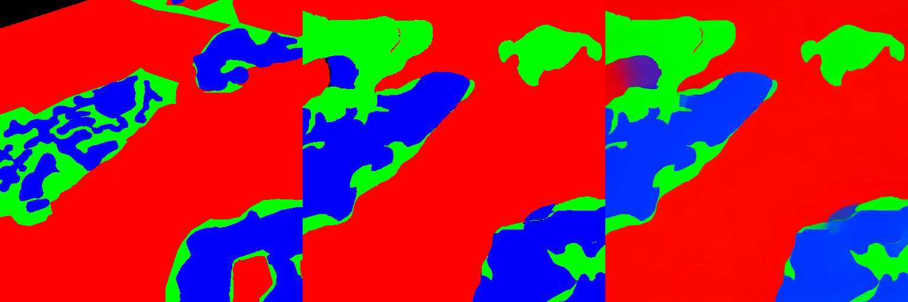

# World Snapshot Models を病理画像で試した記録

World Snapshot Models（WSM v1、[arXiv:2611.24917](https://arxiv.org/abs/2611.24917)、[プロジェクトページ](https://world-snapshot.github.io/WSMs/)）が H&E 病理画像で実用になるかを、乳腺の公開ベンチマーク 2 つで確かめた。期間は 2026-11-21〜25。

WSM は、凍結した画像生成モデル（FLUX.2 Klein 4B）に、タスクごとの小さな追加部品（約 1250 万パラメータ）を学習させ、あらゆる視覚タスクを「入力画像から出力画像を生成する」問題として解く方式。論文は病理を課題の一覧に挙げているが、実験はしていない。

## 結論

**病理では、既存の基盤モデル（UNI2-h）に線形分類器を載せる方法を超えなかった。WSI 全体の診断への拡張は見送る。**

1. **コードを変えずに病理画像で学習できる。** A6000（48 GB）1 枚で動く。
2. **ROI の分類（BRACS、7 クラス）は、UNI2-h + 線形に並ぶが上回らない。** 学習に半日、推論に 1 枚 4〜5 秒かかるので、分類に使う理由が無い。
3. **組織セグメンテーション（BCSS、5 クラス）は、DINOv2 + 線形デコーダを test でわずかに上回った。** ただし val では同等で、UNI との比較はできていない。
4. **論文の分類の構成（入力の潜在表現 + 小さな CNN）は、BRACS ではさらに低い。**
5. **推論が遅い。** 1 タイル 4〜5 秒で、1 万タイルの WSI なら約 12 時間かかる。特徴抽出型より 2 桁遅い。

強みが生きるのは「多種類の画素単位の出力を 1 つの仕組みで扱いたい」「その領域に強い基盤モデルが無い」場面で、病理の診断はどちらにも当てはまりにくい。

## やったこと

| 段階 | 内容 | 実験 |
|---|---|---|
| 動作確認 | 公開済みの部品で推論を再現し、VRAM と速度を測った | 0001 |
| 学習なしの確認 | H&E 画像とマスクを VAE に往復させ、情報が残るかを見た | 0003 |
| BRACS の準備 | NAS の WSI と注釈から ROI を 4540 個切り出した（公式分割: 3658 / 312 / 570） | 0002、0004 |
| BRACS の分類 | 出力をクラス色で塗った画像にして学習し、色の多数決でクラスを読んだ | 0005、0006 |
| 比較対象 | UNI2-h のパッチ埋め込みを ROI で平均し、ロジスティック回帰にかけた | 0007 |
| UNI を条件に追加 | UNI の特徴を WSM の追加の条件として与えた | 0008 |
| BCSS のセグメンテーション | 出力をクラス色で塗り分けた画像にして学習した | 0009〜0011 |
| 比較対象 | DINOv2 ViT-L/14 の特徴に線形の層を載せた | 0012 |
| 論文の分類の構成 | 入力の VAE 潜在表現を小さな CNN で分類する著者の方法を当てた | 0013 |

## 結果

### BRACS: ROI の 7 クラス分類（test 570 枚）

入力は ROI 中央の 512 px タイル 1 枚（10 倍は 2048 px 四方、20 倍は 1024 px 四方を縮小）。条件は val（312 枚）で選び、test は各モデル 1 回。

| モデル | val 正解率 / macro-F1 | test 正解率 / macro-F1 |
|---|---|---|
| UNI2-h + 線形（範囲 2048） | 0.657 / 0.647 | 0.611 / 0.600 |
| UNI2-h + 線形（範囲 1024） | 0.692 / 0.673 | 0.590 / 0.573 |
| WSM 20 倍 + UNI、9000 ステップ | 0.699 / 0.670 | 0.588 / 0.570 |
| WSM 10 倍、9000 ステップ | 0.628 / 0.598 | 0.574 / 0.557 |
| WSM 20 倍、9000 ステップ | 0.651 / 0.636 | 0.561 / 0.545 |
| 著者の分類の構成、10 倍（3 シード平均） | 0.523 / 0.498 | 0.426 / 0.400 |
| 著者の分類の構成、20 倍（3 シード平均） | 0.450 / 0.422 | 0.415 / 0.382 |

- WSM の行はすべてバッチ 4。著者の既定（バッチ 1）では分類が不安定だった。バッチ 4 は VRAM 44 GB で A6000 の上限。
- 著者の分類の構成は、入力画像の VAE 潜在表現だけを見る約 154 万パラメータの CNN で、追加部品も生成結果も使わない。学習データに過適合した。
- どのモデルも test は val より 0.04〜0.10 低い。

### BCSS: 組織の 5 クラスセグメンテーション（test 450 タイル）

入力は 20 倍相当（0.5 µm/px）の 512 px タイル。

| モデル | val 画素正解率 / mIoU | test 画素正解率 / mIoU / 平均 Dice |
|---|---|---|
| WSM、バッチ 4、6000 ステップ | 0.794 / 0.561 | 0.808 / 0.611 / 0.751 |
| DINOv2 ViT-L/14 + 線形デコーダ | 0.783 / 0.569 | 0.795 / 0.580 / 0.727 |

test のクラス別 IoU（WSM / DINOv2）: 腫瘍 0.786 / 0.749、間質 0.675 / 0.676、炎症 0.594 / 0.541、壊死 0.602 / 0.534、その他 0.398 / 0.402。

test の先頭 2 例（選んでいない）。左から 正解 / 予測 / 生成画像そのまま。赤が腫瘍、緑が間質、青が炎症。

1 例目は領域の位置がおおむね合うが、細かい入り組みは再現されない。2 例目は正解がほぼ全面腫瘍なのに、間質や壊死を広く出して外れている。

### コスト（A6000 1 枚）

| 項目 | WSM | 比較対象 |
|---|---|---|
| 学習 | バッチ 4 で約 5.3 秒/ステップ。9000 ステップで約 13 時間 | UNI + ロジスティック回帰は数分。DINOv2 + 線形デコーダは 4 分 |
| 推論 | 512 px タイル 1 枚あたり 4.3〜4.7 秒 | DINOv2 の特徴抽出は 0.07 秒/タイル |
| VRAM | 推論 15 GB、学習はバッチ 4 で 44 GB | — |

### 学習なしで確かめたこと

FLUX.2 の VAE に H&E 画像を往復させても情報はよく残る（40 倍で PSNR 33.7、核領域の一致度 0.94）。二値マスクの往復もほぼ無損失（Dice 0.999）。出力を色分け画像にする方式は、表現の面では問題にならない。

## 確かめていないこと

- **UNI2-h とのセグメンテーション比較。** 計算ノードから重みを取得できなかった。BCSS での WSM の優位は、この比較をしない限り主張できない。
- **BCSS の分割の照合。** test の施設の組（OL、LL、E2、EW、GM、S3）は記憶に基づく指定で、公式との照合が済んでいない。既報値との比較もしていない。
- **比較対象の調整。** UNI + 線形の正則化は格子の端が選ばれ、DINOv2 + 線形は最良が最終エポックだった。どちらも、もう少し上がる可能性がある。
- **少数ショットでの比較、仮想染色などの画像変換、WSI 全体への拡張。** いずれも未着手。
- **関連研究の一次確認。** `docs/RELATED_WORK.md` で「未」とした文献。

## ファイルの場所

| 場所 | 内容 |
|---|---|
| `docs/RESULTS.md` | 結果の詳細（全条件の表） |
| `docs/PROGRESS.md` | 作業の経過と判断の記録 |
| `docs/WSM_TRAINING_RECIPE.md` | WSM を独自データで学習する手順 |
| `docs/RELATED_WORK.md` | 関連研究の調査 |
| `docs/PLAN.md`、`docs/consult/` | 当初の計画と、Codex・Agy との相談の記録 |
| `experiments/` | 実験ごとのコード、設定、まとめ（`report.yaml`） |
| `tools/` | データ取得、ROI 切り出し、WSM への修正（`tools/patches/`） |
| `docs/TEMPLATE_USAGE.md` | このリポジトリの土台になっている実験管理テンプレートの使い方 |

実験の出力（`outputs/`）、学習済みの重み、データはコミットしていない。クラスタの `/workspace/filesrv02/honzawa/united-law-for-pathological-tasks/` と `/workspace/filesrv02/honzawa/data/{bracs,bcss}/` にある。

## 再現するとき

1. `libraries/WSMs/` に WSM のコードを clone し、`tools/patches/` の 2 つのスクリプトを実行する。
2. 依存を入れる: `make uv_sync p=small-creator extras="wsm patho"`。
3. 実験を番号順に投入する。対象は投入時に環境変数で渡す（各 `run_slurm.sh` の冒頭を参照）。

WSM のコードと重みは Rutgers の非商用研究ライセンス、FLUX.2 Klein 4B は Apache 2.0。
